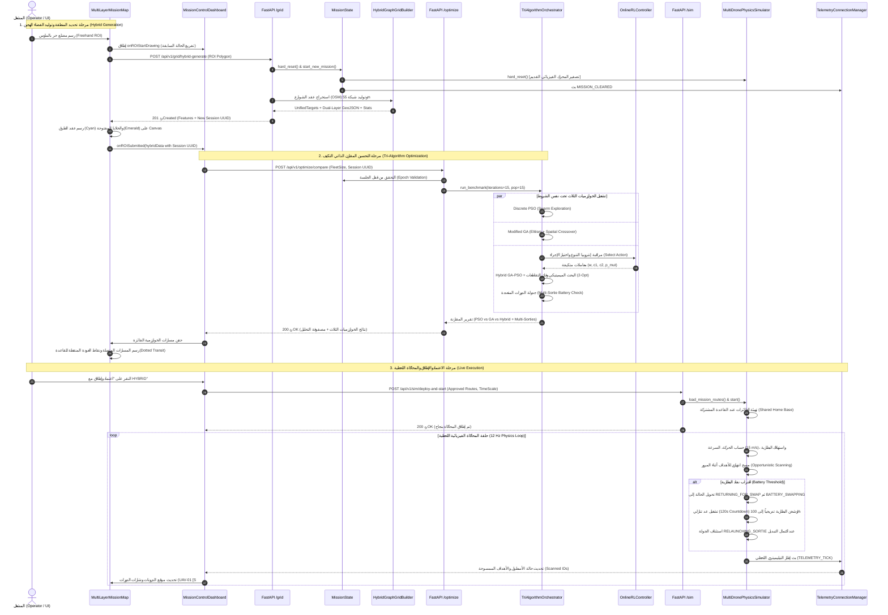
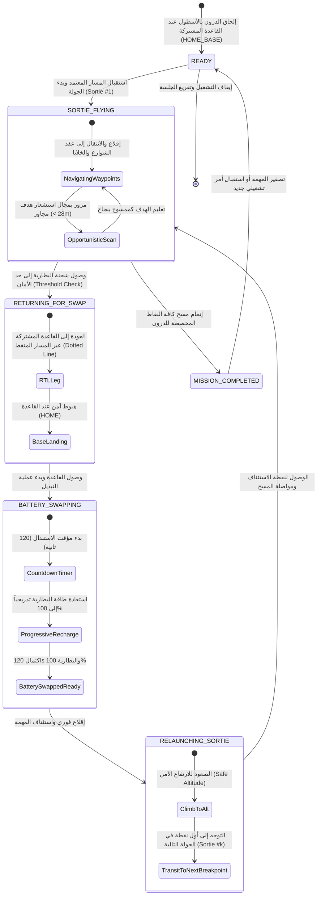
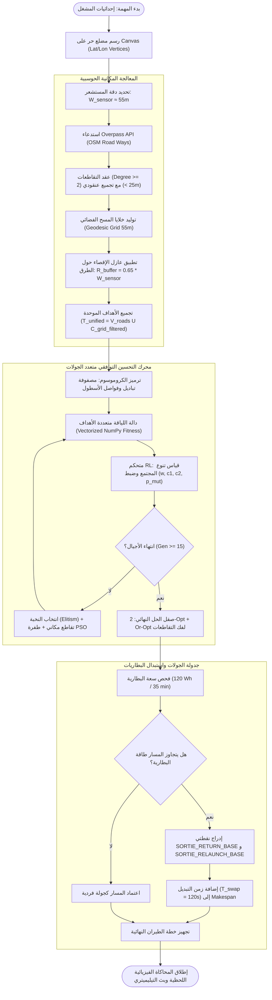

# معمارية النظام ومخططات UML الشاملة
## نظام التخطيط الجغرافي التكيفي متعدد الطائرات المسيرة
### Adaptive Multi-Drone Search & Terrain Mapping System

---

## فهرس المحتويات
1. [نظرة عامة على المعمارية الهندسية (System Architecture Overview)](#1-نظرة-عامة-على-المعمارية-الهندسية)
2. [مخطط الحزم والمكونات البرمجية (Package & Component Diagram)](#2-مخطط-الحزم-والمكونات-البرمجية)
3. [مخطط الفئات الهيكلي الشامل (Comprehensive Class Diagram)](#3-مخطط-الفئات-الهيكلي-الشامل)
4. [مخطط التتابع لدورة حياة المهمة (End-to-End Mission Sequence Diagram)](#4-مخطط-التتابع-لدورة-حياة-المهمة)
5. [مخطط آلة الحالات لحركة الدرون والجولات المتعددة (Drone State Machine Diagram)](#5-مخطط-آلة-الحالات-لحركة-الدرون-والجولات-المتعددة)
6. [مخطط تدفق العمليات الحسابية (Activity & Data Flow Diagram)](#6-مخطط-تدفق-العمليات-الحسابية)

---

## 1. نظرة عامة على المعمارية الهندسية

يعتمد النظام معمارية متعددة الطبقات موجهة بالأحداث والفيزياء اللحظية (**Event-Driven Multi-Tier Physical Architecture**)، مصممة للعمل المستقل والتوسع الديناميكي لأي حجم أسطول ($N \ge 1$):

* **طبقة العرض والتحكم (Frontend UI Layer):** مبنية باستخدام `React` + `TypeScript` + `HTML5 Canvas 2D` + `Tailwind CSS`، توفر تحكماً لحظياً وتنسيقاً مرناً بدون أي تداخل أو طفح في النصوص، وتدعم عرض الخرائط الجغرافية الحقيقية (Satellite / Streets Slippy Map Tiles).
* **بوابة الاتصال وإدارة الجلسات (API & Gateway Layer):** مبنية باستخدام `FastAPI` و `WebSockets`، تدير قفل الجلسات الحتمي عبر معرّفات المعاملات الفريدة (`Mission Session Epoch UUID`)، وتبث بيانات التيليميتري بتردد $12\text{ Hz}$.
* **محرك المعلومات الجغرافية والتفريق المكاني (Geodesic GIS & Topology Engine):** يستخلص تقاطعات الشوارع وعقد الطرق الحضرية من `OpenStreetMap` عبر بروتوكول Overpass API، ويبني شبكة خلايا مسح أرضي متساوية المساحة بدقة المستشعر الفيزيائي الفعلي ($55\text{ m}$)، ويدمج الطبقتين مع تطبيق عازل إقصاء مكاني لحظر أي ازدواجية مسح (Zero-Overlap).
* **محرك التحسين التوافقي ذاتي التكيف (Online RL-Guided Optimization Suite):** يضم الخوارزميات الثلاث (`Discrete PSO`, `Modified GA`, `Hybrid GA-PSO`) المزودة بمتحكم تعلم معزز لحظي (Instant Q-Learning Controller) يضبط المعاملات ($w, c_1, c_2, p_{\text{mut}}$) تلقائياً، ومحرك فك تقاطع المسارات الانتهازي والموازنة الميميتيكية متعددة الجولات (`Multi-Sortie Memetic Load Balancing`).
* **محرك المحاكاة الفيزيائية وديناميكا البطاريات (Real-Time Physics & Battery Dynamics Kernel):** حلقة غير متزامنة (`asyncio`) تحاكي الطيران الفيزيائي، استهلاك الطاقة اللحظي ($15\text{ m/s}$، $120\text{ Wh}$)، المسح الانتهازي للأهداف أثناء العبور، ودورة استبدال البطاريات في القاعدة المشتركة مع عد تنازلي ($120\text{ s}$).

---

## 2. مخطط الحزم والمكونات البرمجية

يوضح هذا المخطط توزيع الحزم البرمجية والعلاقات المتبادلة بين الطبقات:

```mermaid
flowchart TD
    subgraph Presentation_Layer["طبقة واجهة المستخدم (Presentation Layer - React + Vite)"]
        UI_Dash["MissionControlDashboard"]
        UI_Map["MultiLayerMissionMap (HTML5 2D Canvas)"]
        UI_Panel["AlgorithmSegmentedPanel"]
        UI_Modal["BenchmarkComparisonModal"]
        UI_Fleet["ManualFleetManager"]
        UI_Socket["useTelemetrySocket Hook"]
    end

    subgraph Gateway_Layer["طبقة البوابة والاتصال (FastAPI Gateway)"]
        API_Grid["Grid Router (/api/v1/grid)"]
        API_Opt["Optimize Router (/api/v1/optimize)"]
        API_Sim["Simulation Router (/api/v1/sim)"]
        API_Fleet["Fleet Router (/api/v1/fleet)"]
        WS_Hub["TelemetryConnectionManager (/ws/telemetry)"]
        Session_Mgr["MissionState (Session Epoch UUID)"]
    end

    subgraph GIS_Engine["محرك المعلومات الجغرافية (Computational GIS Engine)"]
        OSM_Ext["RoadTopologyExtractor (OSM Overpass + Synthesizer)"]
        Geo_Grid["GeodesicGridDiscretizer"]
        Hybrid_Builder["HybridGraphGridBuilder (Zero-Overlap Exclusion Buffer)"]
    end

    subgraph Optimization_Engine["محرك التحسين المقارن (Optimization Engine)"]
        Evaluator["MultiObjectiveFitnessEvaluator (Vectorized NumPy)"]
        RL_Ctrl["OnlineRLParameterController (Q-Table Adaptation)"]
        Engine_PSO["DiscretePSOOptimizer"]
        Engine_GA["ModifiedGAOptimizer"]
        Engine_Hybrid["HybridGAPSOOptimizer"]
        Memetic_Bal["Sortie-Inclusive Memetic Balancing"]
        Untangle_Opt["2-Opt / Or-Opt Route Untangler"]
        Route_Analytics["GeometricRouteAnalyzer (Ranking & Ties)"]
        Tri_Orch["TriAlgorithmOrchestrator"]
    end

    subgraph Physics_Simulation["محرك المحاكاة الفيزيائية اللحظية (Physics Kernel)"]
        Sim_Engine["MultiDronePhysicsSimulator (12Hz Loop)"]
        Fleet_Reg["FleetRegistry"]
        Battery_Swap["Multi-Sortie Breakpoint & Battery-Swap Engine"]
        Opportunistic["Opportunistic In-Flight Target Scanner"]
    end

    %% Presentation to Gateway Links
    UI_Dash --> UI_Map
    UI_Dash --> UI_Panel
    UI_Dash --> UI_Modal
    UI_Dash --> UI_Fleet
    UI_Dash --> UI_Socket

    UI_Map -->|POST /hybrid-generate| API_Grid
    UI_Panel -->|POST /optimize/compare| API_Opt
    UI_Panel -->|POST /sim/deploy-and-start| API_Sim
    UI_Socket <-->|WebSocket Stream @ 12Hz| WS_Hub

    %% Gateway to Subsystems
    API_Grid --> Session_Mgr
    API_Grid --> OSM_Ext
    API_Grid --> Geo_Grid
    API_Grid --> Hybrid_Builder

    API_Opt --> Session_Mgr
    API_Opt --> Tri_Orch
    Tri_Orch --> Evaluator
    Tri_Orch --> Engine_PSO
    Tri_Orch --> Engine_GA
    Tri_Orch --> Engine_Hybrid
    Engine_Hybrid --> RL_Ctrl
    Engine_Hybrid --> Memetic_Bal
    Engine_Hybrid --> Untangle_Opt
    Tri_Orch --> Route_Analytics

    API_Sim --> Session_Mgr
    API_Sim --> Sim_Engine
    Sim_Engine --> Fleet_Reg
    Sim_Engine --> Battery_Swap
    Sim_Engine --> Opportunistic
    Sim_Engine -.->|Broadcast Frames| WS_Hub
```

---

## 3. مخطط الفئات الهيكلي الشامل (Comprehensive Class Diagram)

يوضح المخطط التالي بنية الفئات (Classes)، الحقول (Fields)، الدوال (Methods)، والعلاقات التركيبية والوراثية:

```mermaid
classDiagram
    %% GIS Subsystem
    class GridCell {
        +int cell_id
        +int row
        +int col
        +float center_lat
        +float center_lon
        +List~Tuple~ corners
        +float area_m2
        +float elevation_m
        +float terrain_roughness
        +float priority
        +bool is_masked_out
        +bool is_scanned
        +to_geojson_feature() Dict
        +to_dict() Dict
    }

    class GeodesicGridDiscretizer {
        +float lat_min
        +float lat_max
        +float lon_min
        +float lon_max
        +float cell_size_m
        +List~GridCell~ cells
        +Dict~int, GridCell~ spatial_index
        +int active_cell_count
        +build_grid() void
        +to_geojson() Dict
    }

    class RoadIntersectionNode {
        +str node_id
        +float lat
        +float lon
        +int degree
        +int cluster_size
        +List~str~ connected_edges
        +to_dict() Dict
    }

    class RoadEdge {
        +str edge_id
        +str u
        +str v
        +float length_m
        +str highway_type
        +List~Tuple~ geometry
    }

    class ExtractedRoadNetwork {
        +Dict~str, RoadIntersectionNode~ nodes
        +List~RoadEdge~ edges
        +str source
        +int original_node_count
        +int clustered_node_count
    }

    class RoadTopologyExtractor {
        +Dict~str, ExtractedRoadNetwork~ cache
        +float timeout_sec
        +fetch_road_topology(bounds, cluster_thresh) ExtractedRoadNetwork
        -_synthesize_grid_topology() ExtractedRoadNetwork
    }

    class UnifiedTarget {
        +str target_id
        +str target_type
        +float lat
        +float lon
        +float alt_m
        +float priority
        +float safe_alt_m
        +int degree
        +to_dict() Dict
        +to_geojson_feature() Dict
    }

    class HybridGraphGridBuilder {
        +GeodesicGridDiscretizer grid
        +ExtractedRoadNetwork road_network
        +float buffer_radius_m
        +List~UnifiedTarget~ unified_targets
        +List~RoadIntersectionNode~ active_road_nodes
        +List~GridCell~ active_open_cells
        +build_hybrid_space() void
        +to_dual_layer_geojson() Dict
    }

    %% Optimization Subsystem
    class MultiObjectiveFitnessEvaluator {
        +List~UnifiedTarget~ active_targets
        +List~DroneTelemetry~ fleet
        +int n_drones
        +int m_cells
        +float w_time
        +float w_energy
        +float w_balance
        +float w_priority
        +evaluate(chromosome) Tuple~float, Dict~
        +fast_evaluate(chromosome) float
        +calculate_sorties(route) Tuple~int, List~
    }

    class OnlineRLParameterController {
        +ndarray Q_table
        +int current_state
        +float prev_entropy
        +observe_state(population, diversity) int
        +select_action(state) int
        +update_q(state, action, reward, next_state) void
    }

    class DiscretePSOOptimizer {
        +MultiObjectiveFitnessEvaluator evaluator
        +int swarm_size
        +int max_iterations
        +float w
        +float c1
        +float c2
        +optimize() Dict
    }

    class ModifiedGAOptimizer {
        +MultiObjectiveFitnessEvaluator evaluator
        +int population_size
        +int generations
        +float crossover_rate
        +float mutation_rate
        +optimize() Dict
    }

    class HybridGAPSOOptimizer {
        +MultiObjectiveFitnessEvaluator evaluator
        +OnlineRLParameterController rl_controller
        +int pop_swarm_size
        +int generations
        +List~Dict~ rl_adaptation_log
        +optimize() Dict
        -_apply_2opt_untangle(route) List
        -_apply_or_opt(route) List
        -_rebalance_sorties_memetic(routes) Dict
    }

    class TriAlgorithmOrchestrator {
        +MultiObjectiveFitnessEvaluator evaluator
        +run_benchmark(iterations, pop_size) Dict
    }

    class GeometricRouteAnalyzer {
        +calculate_route_intersections(routes) int
        +calculate_redundant_revisits(routes, radius_m) int
        +build_comparative_matrix(pso_res, ga_res, hyb_res) Dict
    }

    %% Simulation & Fleet Subsystem
    class DroneStatus {
        <<enumeration>>
        READY
        SEARCHING
        MAPPING
        RTL
        SORTIE_FLYING
        RETURNING_FOR_SWAP
        BATTERY_SWAPPING
        RELAUNCHING_SORTIE
        MISSION_COMPLETED
        OFFLINE
    }

    class DroneNodeConfig {
        +str drone_id
        +str endpoint_uri
        +float cruise_speed_mps
        +float battery_capacity_wh
        +float initial_lat
        +float initial_lon
    }

    class DroneTelemetry {
        +str drone_id
        +DroneStatus status
        +float lat
        +float lon
        +float altitude_m
        +float speed_mps
        +float heading_deg
        +float battery_pct
        +int current_sortie
        +int total_sorties
        +float swap_remaining_sec
    }

    class FleetRegistry {
        +Dict~str, DroneNodeConfig~ drones
        +add_drone(config) void
        +remove_drone(id) void
        +get_immutable_snapshot() List~DroneTelemetry~
    }

    class MultiDronePhysicsSimulator {
        +str state
        +float time_scale
        +Tuple~float, float~ home_base
        +Dict~str, List~ routes
        +Dict~str, DroneTelemetry~ drone_states
        +Set~str~ scanned_target_ids
        +load_mission_routes(algo, routes, fleet, home_base) void
        +start() void
        +pause() void
        +stop_and_reset() void
        +hard_reset() void
        -_physics_tick(dt) void
    }

    class MissionState {
        +str mission_id
        +float created_at
        +Dict bounds
        +Tuple home_base
        +start_new_mission(bounds, vertices, home_base) str
        +hard_reset() void
    }

    class TelemetryConnectionManager {
        +List~WebSocket~ active_connections
        +connect(websocket) void
        +disconnect(websocket) void
        +broadcast(payload) void
    }

    %% Relationships
    GeodesicGridDiscretizer *-- GridCell : contains
    ExtractedRoadNetwork *-- RoadIntersectionNode : contains
    ExtractedRoadNetwork *-- RoadEdge : contains
    RoadTopologyExtractor ..> ExtractedRoadNetwork : produces
    HybridGraphGridBuilder o-- GeodesicGridDiscretizer : discretizes
    HybridGraphGridBuilder o-- ExtractedRoadNetwork : extracts
    HybridGraphGridBuilder *-- UnifiedTarget : fuses

    MultiObjectiveFitnessEvaluator o-- UnifiedTarget : evaluates
    MultiObjectiveFitnessEvaluator o-- DroneTelemetry : evaluates
    TriAlgorithmOrchestrator o-- MultiObjectiveFitnessEvaluator : coordinates
    TriAlgorithmOrchestrator ..> DiscretePSOOptimizer : runs
    TriAlgorithmOrchestrator ..> ModifiedGAOptimizer : runs
    TriAlgorithmOrchestrator ..> HybridGAPSOOptimizer : runs
    HybridGAPSOOptimizer *-- OnlineRLParameterController : adapts

    FleetRegistry *-- DroneNodeConfig : manages
    DroneTelemetry -- DroneStatus : typed by
    MultiDronePhysicsSimulator o-- FleetRegistry : reads
    MultiDronePhysicsSimulator *-- DroneTelemetry : updates
    MultiDronePhysicsSimulator ..> TelemetryConnectionManager : streams to
    MissionState ..> MultiDronePhysicsSimulator : controls
```

---

## 4. مخطط التتابع لدورة حياة المهمة (End-to-End Mission Sequence Diagram)

يوضح المخطط التسلسل الزمني الكامل لخط الأنابيب بدءاً من رسم المشغّل للمنطقة على الخريطة وصولاً إلى المحاكاة الفيزيائية اللحظية:

---

## 5. مخطط آلة الحالات لحركة الدرون والجولات المتعددة (Drone State Machine Diagram)

يوضح هذا المخطط دورة حياة الطائرة المسيرة وحالات الانتقال الفيزيائية وجدولة استبدال البطاريات المتتابعة:

---

## 6. مخطط تدفق العمليات الحسابية (Activity & Data Flow Diagram)

يوضح المخطط كيفية تحويل الإحداثيات الجغرافية الخام إلى مضلعات هجينة، ثم تمثيلها جينياً، وتطبيق التحسين متعدد المعايير، وصياغة الجولات الفيزيائية:

---

## 7. ملخص المعايير الهندسية وأنماط التصميم المعتمدة (Design Patterns & Specs)

| المعيار الهندسي / النمط | المكون المطبق | الوظيفة الفنية |
| :--- | :--- | :--- |
| **Deterministic Session Epoch** | `MissionState` | قفل حتمي يمنع تسرب أو تداخل مسارات الجلسات السابقة باستخدام UUID |
| **Zero-Overlap Spatial Buffer** | `HybridGraphGridBuilder` | عزل مكاني يحظر الازدواجية بين تقاطعات الطرق وخلايا الفضاء المفتوح |
| **Online Q-Learning Adaptation** | `OnlineRLParameterController` | تعديل ديناميكي فوري لمعاملات PSO/GA خلال الأجيال بدون أي تدريب مسبق |
| **Multi-Sortie Relay Engine** | `MultiDronePhysicsSimulator` | تقسيم آلي للمهام الطويلة إلى جولات متعددة مع محاكاة استبدال البطاريات في 120 ثانية |
| **Opportunistic Spatial Indexing** | `SimulatorEngine` | استشعار انتهازي يلتقط الأهداف المجاورة أثناء مسار العبور دون انحراف إضافي |
| **Observer / Pub-Sub Pattern** | `TelemetryConnectionManager` | بث غير متزامن لبيانات الطيران الحية عبر WebSockets بتردد 12 إطاراً بالثانية |
| **Auto-Layout Flex-Wrap Pattern** | `MissionControlDashboard` | مرونة عرض تمنع تداخل الأزرار وطفح النصوص على مختلف الدقات (1280px إلى 2560px) |

---
**تم إنشاء هذا المخطط المعماري الشامل وتضمينه في مجلد المشروع في المسارين:**
1. [UML_ARCHITECTURE.md](file:///d:/desectop/third%20stage%20first%20course/optimizing%20algorithm/project/Adaptive_multi_drones/UML_ARCHITECTURE.md)
2. [docs/UML_ARCHITECTURE.md](file:///d:/desectop/third%20stage%20first%20course/optimizing%20algorithm/project/Adaptive_multi_drones/docs/UML_ARCHITECTURE.md)
